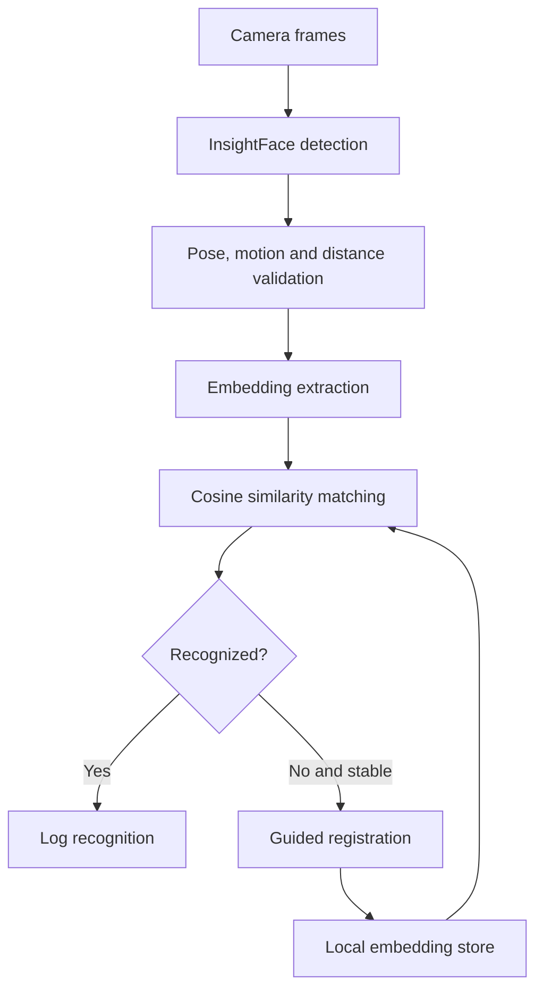

# Real-Time Face Recognition System

A local face enrollment and recognition system built with InsightFace, ONNX Runtime, OpenCV, and NumPy. It supports guided multi-angle registration, pose and motion checks, duplicate detection, configurable matching thresholds, and headless operation.

> **Focus:** Computer Vision · Perception · Real-Time Inference · Robust System Design

## What the system does

- Registers a person from five guided head poses.
- Stores multiple embeddings per pose to improve matching across viewpoints.
- Detects faces and extracts 512-dimensional embeddings locally.
- Matches embeddings using normalized cosine similarity.
- Rejects unsuitable frames using pose, motion, and distance checks.
- Recovers from repeated camera failures without restarting the application.
- Runs without external recognition APIs or cloud processing.

## Architecture



## Technology stack

| Area | Technologies |
|---|---|
| Language | Python 3.10+ |
| Detection and embeddings | InsightFace, RetinaFace, MBF |
| Inference | ONNX Runtime |
| Image processing | OpenCV |
| Matching | NumPy cosine similarity |
| Numerical utilities | SciPy |
| Storage | Local JSON |
| Deployment | Docker/headless-compatible execution |

## Main components

| Component | Responsibility |
|---|---|
| `main.py` | Camera loop, recognition flow, buffering, and recovery |
| `capture_manager.py` | Guided multi-angle enrollment |
| `face_analyzer.py` | Detection and embedding extraction |
| `face_validator.py` | Pose and distance validation |
| `faiss_manager.py` | NumPy-based similarity search |
| `motion_detector.py` | Frame and bounding-box stability checks |
| `unknown_tracker.py` | Tracking unknown faces before enrollment |
| `display_compat.py` | GUI and headless compatibility |
| `data_manager.py` | Local embedding persistence |
| `config.py` | Centralized thresholds and runtime parameters |

## Design decisions

### NumPy instead of FAISS

The expected dataset is below 1,000 identities. NumPy cosine similarity is sufficiently fast at this scale and avoids platform-sensitive binary dependencies. The trade-off is linear search time if the dataset becomes much larger.

### Multi-angle enrollment

Enrollment captures straight, left, right, upward, and downward poses. Three embeddings per pose provide viewpoint diversity without making registration excessively long.

### Consecutive-frame confirmation

A match must remain consistent across consecutive frames before recognition is confirmed. This adds a short delay but reduces single-frame instability.

### Centralized configuration

Similarity thresholds, pose tolerances, distance assumptions, stability timings, and camera parameters live in one configuration module so the system can be calibrated without changing the recognition flow.

## Installation

```bash
python -m venv .venv

# Linux or macOS
source .venv/bin/activate

# Windows
.venv\Scripts\activate

pip install -r requirement.txt
```

Run the main application:

```bash
python Insight_Face_Recognition/main.py
```

The first run may download the configured InsightFace model files.

## Configuration notes

- Camera focal length must be calibrated before relying on estimated distance.
- Matching thresholds should be validated with representative users and lighting.
- Stored embeddings are biometric data and must be protected appropriately.
- The current JSON storage is suitable for a prototype; a larger deployment should use access-controlled persistent storage.

## Validation scope

In a five-minute local test, the system recorded 83 recognitions with no observed false positives. CPU inference was approximately 100 ms per processed frame in the tested environment. These are prototype measurements, not general benchmark claims; results depend on the camera, hardware, lighting, enrolled identities, and thresholds.

## Limitations

- Current tracking is primarily designed around a single prominent face.
- Distance estimation depends on camera calibration and an assumed face width.
- The system does not provide dedicated liveness or presentation-attack detection.
- JSON-based storage and linear matching are not intended for large identity databases.

## Potential extensions

- Multi-face tracking
- Dedicated liveness detection
- Automated evaluation across lighting and pose conditions
- Encrypted biometric storage
- Attendance or access-event export
- Optional GPU inference

## Author

**Samarth Patel**  
Computer Vision · Perception · Python · Edge AI
